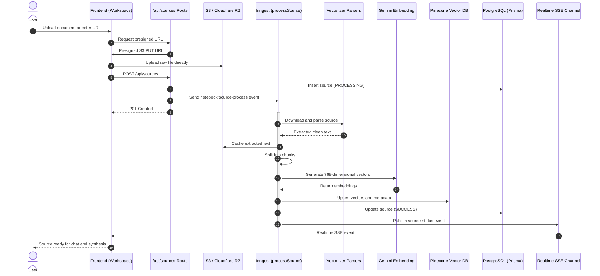
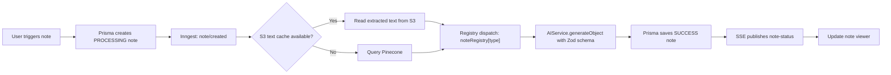
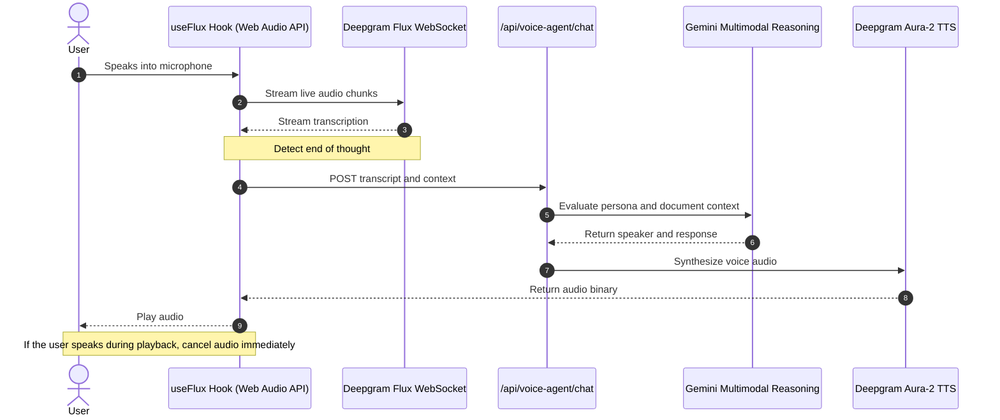
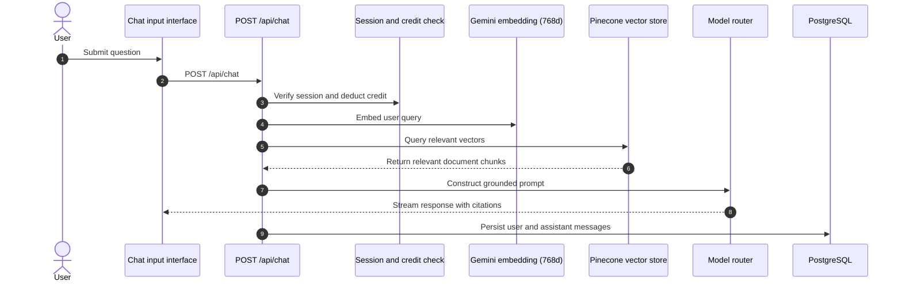

# Infera Notebook · System Architecture

This document provides a comprehensive technical overview of Infera Notebook, detailing the system design, data pipelines, model routing logic, background execution, real-time voice intelligence, and storage strategies.

---

## 🏗️ High-Level System Architecture

Infera Notebook is architected as an event-driven, serverless system optimized for ultra-low-latency interactive retrieval, high-throughput document ingestion, and multi-format content generation.

```mermaid
flowchart TD
    %% Client Layer
    subgraph Client["Client Layer - Next.js 16 / React 19"]
        UI["Workspace UI / Notebook Shell"]
        ChatUI["Semantic Chat & Citations"]
        NotesUI["12 Dynamic Note Renderers"]
        VoiceUI["Flux Voice Agent / Gemini Live UI"]
        RemotionPlayer["Remotion Video Player"]
    end

    %% API Layer
    subgraph Server["Next.js Server & Route Handlers"]
        AuthMiddleware["Better Auth & Session Guard"]
        APIRouter["API Route Handlers"]
        CreditService["Credit & Quota Manager"]
        ChatAPI["/api/chat - RAG Streaming"]
        LiveAPI["/api/live/config - Ephemeral Tokens"]
        VoiceAPI["/api/voice-agent/chat - Turn Dispatch"]
        S3API["/api/s3 - Presigned Upload URLs"]
        SourceAPI["/api/sources - CRUD & Trigger"]
    end

    %% Background Processing
    subgraph Background["Durable Background Workers - Inngest"]
        InngestBus["Inngest Event Bus"]
        WorkerSource["processSource Worker"]
        WorkerNote["createNote Worker"]
        RealtimePubSub["Inngest Realtime SSE / Pub-Sub"]
    end

    %% Storage
    subgraph Storage["Persistence & Object Stores"]
        Postgres[("Neon PostgreSQL / Prisma ORM")]
        Pinecone[("Pinecone Vector Database")]
        BlobStorage[("Cloudflare R2 / AWS S3")]
        TextCache[("S3 Extracted-Text Cache")]
    end

    %% AI and Speech
    subgraph AI["AI & Speech Intelligence"]
        ModelRouter["Dynamic Task Classifier & Model Router"]
        GeminiFlash["Gemini Flash Models"]
        Gemma["Gemma Workhorse Models"]
        Embeddings["Gemini Embeddings - 768d"]
        DeepgramASR["Deepgram Flux ASR / Nova-3 STT"]
        DeepgramTTS["Deepgram Aura-2 TTS"]
        AssemblyAI["AssemblyAI Speech Intelligence"]
        GeminiLiveWS["Gemini Live API WebSocket"]
    end

    %% Client to API
    UI --> AuthMiddleware
    ChatUI --> ChatAPI
    NotesUI --> APIRouter
    VoiceUI --> VoiceAPI
    VoiceUI <--> GeminiLiveWS

    %% API routing
    AuthMiddleware --> APIRouter
    APIRouter --> CreditService
    APIRouter --> ChatAPI
    APIRouter --> LiveAPI
    APIRouter --> VoiceAPI
    APIRouter --> S3API
    APIRouter --> SourceAPI

    %% API to database and storage
    CreditService --> Postgres
    ChatAPI --> Postgres
    ChatAPI --> Pinecone
    ChatAPI --> ModelRouter
    SourceAPI --> Postgres
    SourceAPI --> InngestBus
    S3API --> BlobStorage
    LiveAPI --> GeminiLiveWS

    %% Background source processing
    InngestBus --> WorkerSource
    WorkerSource --> BlobStorage
    WorkerSource --> TextCache
    WorkerSource --> Embeddings
    Embeddings --> Pinecone
    WorkerSource --> Postgres
    WorkerSource --> RealtimePubSub

    %% Background note generation
    InngestBus --> WorkerNote
    WorkerNote --> TextCache
    WorkerNote --> Pinecone
    WorkerNote --> ModelRouter
    WorkerNote --> Postgres
    WorkerNote --> RealtimePubSub

    %% AI routing
    ModelRouter --> GeminiFlash
    ModelRouter --> Gemma
    VoiceAPI --> ModelRouter
    VoiceAPI --> DeepgramTTS

    %% Voice processing
    VoiceUI <--> DeepgramASR
    VoiceUI <--> DeepgramTTS
    VoiceUI <--> AssemblyAI

    %% Realtime updates
    RealtimePubSub --> UI
```

---

## 📥 Ingestion & Multi-Format Vectorization Pipeline

When a user adds a source, it undergoes asynchronous parsing, text extraction, caching, chunking, and embedding. Sixteen distinct source types are supported through dedicated vectorizers.

### Supported Vectorizer Loaders

| Source Category | Parser Implementation | Details |
|---|---|---|
| PDF | `pdf-parse` / LangChain PDFLoader | Extracts text and handles multi-column layouts |
| Word (.docx) | `mammoth` / `word-extractor` | Preserves headers and body text |
| PowerPoint (.pptx) | `officeparser` | Extracts slide text and presenter notes |
| EPUB | `epub2` | Parses chapters and narrative |
| Text (.txt) | LangChain TextLoader | UTF-8 stream processing |
| Data (CSV, JSON, JSONL) | LangChain DataLoaders | Structured data extraction |
| Subtitles (.srt) | `srt-parser-2` | Normalizes timestamps and dialogue blocks |
| Audio | Deepgram Nova-3 / AssemblyAI | Speech-to-text and speaker diarization |
| Video | Audio extraction + Deepgram | Transcribes audio tracks |
| Websites | `@mendable/firecrawl-js` | Extracts Markdown and removes boilerplate |
| YouTube | `youtubei.js` + Apify fallback | Captures subtitles or transcribes audio |
| GitHub repositories | LangChain GithubLoader | Ingests source code and Markdown documentation |

---

## 🧠 Dynamic Model Router & Resilience Architecture

The AI layer incorporates a specialized model router at `src/lib/llm/model-router.ts`.

1. Bounded syntax-based task classification analyzes prompt patterns to select the appropriate model tier.
2. An in-memory circuit breaker places models experiencing HTTP 429 or 5xx errors into a 60-second cooldown.
3. Separate fallback chains handle reasoning, conversational chat, title generation, and text-to-speech tasks.

```mermaid
flowchart TD
    Prompt["Incoming task or prompt"] --> Classifier{"Bounded task classifier"}

    Classifier -->|Code, architecture, synthesis, notes| ReasoningChain["Reasoning router models"]
    Classifier -->|Conversational chat, QA, follow-ups| ChatChain["Chat router models"]
    Classifier -->|Title and tag generation| TitleChain["Title router models"]
    Classifier -->|Podcast narration| TTSChain["TTS router models"]
    Classifier -->|Real-time voice conversation| LiveChain["Live router models"]

    subgraph ReasoningChainFlow["Reasoning fallback chain"]
        R1["Primary Flash model"] -->|429 or error| R2["Secondary Flash model"]
        R2 -->|429 or error| R3["Flash Lite model"]
        R3 -->|429 or error| R4["Earlier Flash Lite model"]
        R4 -->|429 or error| R5["Gemini 2.5 Flash"]
    end

    subgraph ChatChainFlow["Chat fallback chain"]
        C1["Primary Flash Lite model"] -->|429 or error| C2["Secondary Flash Lite model"]
        C2 -->|429 or error| C3["Higher-tier Flash model"]
        C3 -->|429 or error| C4["Alternative Flash model"]
        C4 -->|429 or error| C5["Gemma workhorse model"]
    end

    subgraph TitleChainFlow["Title generation fallback chain"]
        T1["High-quota Gemma model"] -->|Fallback| T2["Gemma workhorse model"]
        T2 -->|Fallback| T3["Flash Lite model"]
    end

    subgraph TTSChainFlow["Multi-speaker TTS fallback chain"]
        TTS1["Primary Gemini TTS"] -->|Fallback| TTS2["Secondary Gemini TTS"]
        TTS2 -->|Fallback| TTS3["Gemini TTS preview"]
    end
```

---

## 📝 Asynchronous Note Generation Engine

Notes are generated through an isolated background pipeline to prevent HTTP timeouts and preserve UI responsiveness.

### Note Type Implementations

| Note Type | Handler or Implementation | Generation Output |
|---|---|---|
| `EDITABLE_NOTE` | User-created or converted | BlockNote block JSON |
| `CHAT_NOTE` | `/api/chat` save action | Markdown conversation record |
| `AUDIO_OVERVIEW` | `src/lib/notes/audio-overview` | Dialogue script and generated audio |
| `VIDEO_OVERVIEW` | `src/lib/notes/video-overview` | Synchronized slides, audio, and Remotion metadata |
| `MIND_MAP` | `src/lib/notes/mindmap` | XYFlow graph specification |
| `FAQ` | `src/lib/notes/faq` | Questions, answers, and categories |
| `TIMELINE` | `src/lib/notes/timeline` | Dates, titles, and descriptions |
| `BRIEFING_DOC` | `src/lib/notes/briefing` | Executive summary, findings, and recommendations |
| `SLIDE_DECK` | `src/lib/notes/slide-deck` | Slides, bullets, and speaker notes |
| `INFOGRAPHIC` | `src/lib/notes/infographic` | Data sections, metrics, and visual hierarchy |
| `QUIZ` | `src/lib/notes/quiz` | Questions, options, answers, and explanations |
| `FLASH_CARDS` | `src/lib/notes/flash-cards` | Front, back, and category fields |

---

## 🎙️ Dual Real-Time Voice Intelligence

Infera Notebook implements two complementary voice architectures.

### 1. Deepgram Flux ASR & Aura-2 TTS

Designed for conversational Q&A where users discuss document content with custom AI personas.

### 2. Gemini Live API

Uses a direct WebSocket connection for low-latency, bidirectional, multimodal voice conversations.

- Ephemeral session tokens are generated through `/api/live/config`.
- `GeminiLiveAPIClient` manages connections in `src/lib/llm/live-api-client.ts`.
- Supports full-duplex audio input, audio output, and interruption detection.

---

## 🔍 Semantic Search & RAG Chat Pipeline

The interactive chat system balances retrieval accuracy, token efficiency, and response latency.

---

## 🏛️ Data Storage & Security Model

### Persistence Layer

1. **Relational database (Neon PostgreSQL)**
   - Managed using Prisma ORM and a PostgreSQL adapter.
   - Core entities include `User`, `Session`, `Account`, `Verification`, `Notebook`, `Source`, `File`, `Note`, `Chat`, and `Message`.
   - Foreign-key cascades support deletion of related sources, notes, and messages.

2. **Vector store (Pinecone)**
   - Serverless vector index with 768 dimensions and cosine distance.
   - Metadata filtering isolates notebooks and users.

3. **Object storage (Cloudflare R2 / AWS S3)**
   - Stores uploaded files, cached extracted text, and generated audio/video.
   - Presigned URLs allow direct media transfers without proxying files through Next.js.

### Security & Access Control

- **Authentication:** Better Auth with HTTP-only session cookies and Google OAuth.
- **IDOR protection:** API routes verify notebook and source ownership before reading or modifying records.
- **Quota and credit protection:** Daily-resetting credits help control API usage.
- **Input validation:** Zod schemas validate endpoint payloads before execution.

